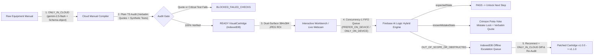

# PokaYoke Studio (Kinetic SOP)

**Cloud-Compiled Visual Assembly & Mistake-Proofing Workstation**  
Built for **Google #BuildHybridAI 2026** using **Firebase AI Logic** (`firebase/ai`), **Chrome Built-in AI (Gemini Nano Multimodal)**, **Firebase App Check**, **React 19 + TypeScript**, **Tailwind CSS v4**, and **IndexedDB** (`idb`).

---

## Architecture Overview

PokaYoke Studio turns static equipment commissioning manuals into deterministic, mistake-proof physical and digital assembly cartridges:



### Key Engineering Guardrails
1. **Honest Telemetry (`inferenceSource`)**: Never reports `ON_DEVICE` unless `result.response.inferenceSource === InferenceSource.ON_DEVICE` (`"on_device"`). Live header tracks `ON_DEVICE` frames, `IN_CLOUD` calls, last latency (`ms`), network status, and `window.LanguageModel` availability.
2. **Concurrency-1 FIFO Mutex Queue**: All hybrid AI calls pass through a sequential FIFO queue (`src/services/hybridAiService.ts`) so `ChromeAdapterImpl` never destroys an active `window.LanguageModel` session during overlapping verification clicks or batch benchmarks.
3. **Multimodal Prompt API Contract**: `onDeviceParams.createOptions` explicitly specifies `expectedInputs: [{ type: 'image' }, { type: 'text' }]`, and `onDeviceParams.promptOptions` passes `{ responseConstraint: stepEnumSchema }`.
4. **Deterministic Compile-Time Audit**: Every `source.verbatimQuote` is normalized and verified character-for-character against `rawManualText`, and synthetic rule tests are evaluated deterministically in plain TypeScript (`src/services/compilerAudit.ts`) before any cartridge becomes `READY`.
5. **Dual-Surface 384×384 ROI Capture**: Both the **Interactive Digital Hardware Workbench** (`<canvas width="384" height="384">`) and **Live Webcam / `.mp4` Stream Cropper** (`640×480` → cropped `384×384` JPEG `Blob`) share the exact same verification pipeline.

---

## Chrome Built-in AI (Gemini Nano Multimodal) Setup

To run **`ONLY_ON_DEVICE`** inference completely offline/air-gapped on Chrome desktop:

1. Use **Chrome 138+** (or Chrome Canary / Dev) on a supported workstation (recommended **16 GB+ RAM** and **4 GB+ VRAM GPU** or Apple Silicon for smooth multimodal execution).
2. Open `chrome://flags` and set:
   - **`chrome://flags/#optimization-guide-on-device-model`** → **`Enabled BypassPerfRequirement`**
   - **`chrome://flags/#prompt-api-for-gemini-nano-multimodal-input`** → **`Enabled`**
3. Relaunch Chrome completely.
4. Open `chrome://components`, find **Optimization Guide On Device Model**, and click **Check for update** until the component downloads and shows a version number.
5. Verify readiness in `chrome://on-device-internals` or in DevTools Console:
   ```js
   await window.LanguageModel.availability({
     expectedInputs: [{ type: 'image' }, { type: 'text' }]
   });
   // Expected: "available"
   ```

---

## Honest Hardware Capability Matrix

| Hardware Profile | Recommended Mode | Behavior |
|---|---|---|
| **4 GB RAM Local Dev PC** (or non-Chrome browser) | `PREFER_ON_DEVICE` | Probes `window.LanguageModel`; when local Nano is `UNSUPPORTED` or `UNAVAILABLE`, Firebase AI Logic transparently falls back to Cloud Gemini and telemetry truthfully increments `IN_CLOUD`. |
| **16 GB RAM / GPU Workstation** (Chrome flags enabled) | `ONLY_ON_DEVICE` | Executes 384×384 multimodal enum verification locally via Chrome Prompt API with zero cloud fallback; telemetry increments `ON_DEVICE`. |
| **Air-Gapped / Offline Bench** | `ONLY_ON_DEVICE` (Nano) or Field Observation | Vision verification runs locally when Nano is `AVAILABLE`; `OUT_OF_SCOPE_OR_OBSTRUCTED` anomalies queue safely in IndexedDB until reconnection. |

---

## Quickstart

### 1. Configure Environment Variables
Copy `.env.example` to `.env` and populate your Firebase project credentials and App Check site key:

```bash
cp .env.example .env
```

- `VITE_FIREBASE_API_KEY`, `VITE_FIREBASE_PROJECT_ID`, `VITE_FIREBASE_APP_ID`, etc. from **Firebase Console → Project Settings** (with **Firebase AI Logic** / Gemini Developer API enabled).
- `VITE_FIREBASE_RECAPTCHA_SITE_KEY` for **Firebase App Check** (`ReCaptchaEnterpriseProvider` by default, or `VITE_FIREBASE_APPCHECK_PROVIDER=v3`).
- `VITE_FIREBASE_APPCHECK_DEBUG_TOKEN=true` for local `localhost` testing.

### 2. Install & Run

```bash
npm install
npm run dev
```

On first launch, PokaYoke Studio automatically seeds IndexedDB with the audited 4-step **EdgeCore XR-400 Commissioning SOP** (`READY` with 100% quote and synthetic test verification) so you can test the Digital Workbench, Mistake Lock, Escalation Queue, and Benchmark Runner immediately.

### 3. Build & Verify

```bash
npm run build
npm test
```

---

## Repository Structure

```text
src/
├── config/
│   └── firebase.ts                   # Firebase App, App Check & GoogleAIBackend setup
├── fixtures/
│   └── defaultRouterCartridge.ts     # Pre-compiled 4-step EdgeCore XR-400 SOP fixture
├── services/
│   ├── compilerAudit.ts              # Deterministic verbatim quote & synthetic test gate
│   ├── hybridAiService.ts            # Hardware probe, FIFO queue, cloud compiler & hybrid verifier
│   └── storageService.ts             # IndexedDB persistence (cartridges, versions, escalations)
├── utils/
│   ├── canvasCapture.ts              # 384x384 JPEG Blob encoder
│   └── workbenchRenderer.ts          # Industrial 384x384 canvas hardware scenes & click zones
├── components/
│   ├── TelemetryHeader.tsx           # Live Nano probe, mode switch & ON_DEVICE/IN_CLOUD counters
│   ├── WorkstationHud.tsx            # Sequential SOP gate, Spacebar verify & Field Observation
│   ├── MistakeLockOverlay.tsx        # Crimson Poka-Yoke lock + verbatim manual citation
│   ├── InteractiveWorkbenchCanvas.tsx# Clickable 384x384 digital hardware workbench
│   ├── WebcamRoiCapture.tsx          # 640x480 webcam / .mp4 cropper -> 384x384 ROI JPEG
│   ├── ModalDialog.tsx               # Native <dialog> modal with light-dismiss fallback
│   ├── CompilerDrawer.tsx            # ONLY_IN_CLOUD manual compiler & audit scoreboard
│   ├── EscalationQueueModal.tsx      # Offline escalation sync, side-by-side diff & v1.1.0 patch
│   └── BenchmarkModal.tsx            # Batch 6-20 crop runner & JSON report exporter
└── App.tsx                           # Main workstation application shell
```
